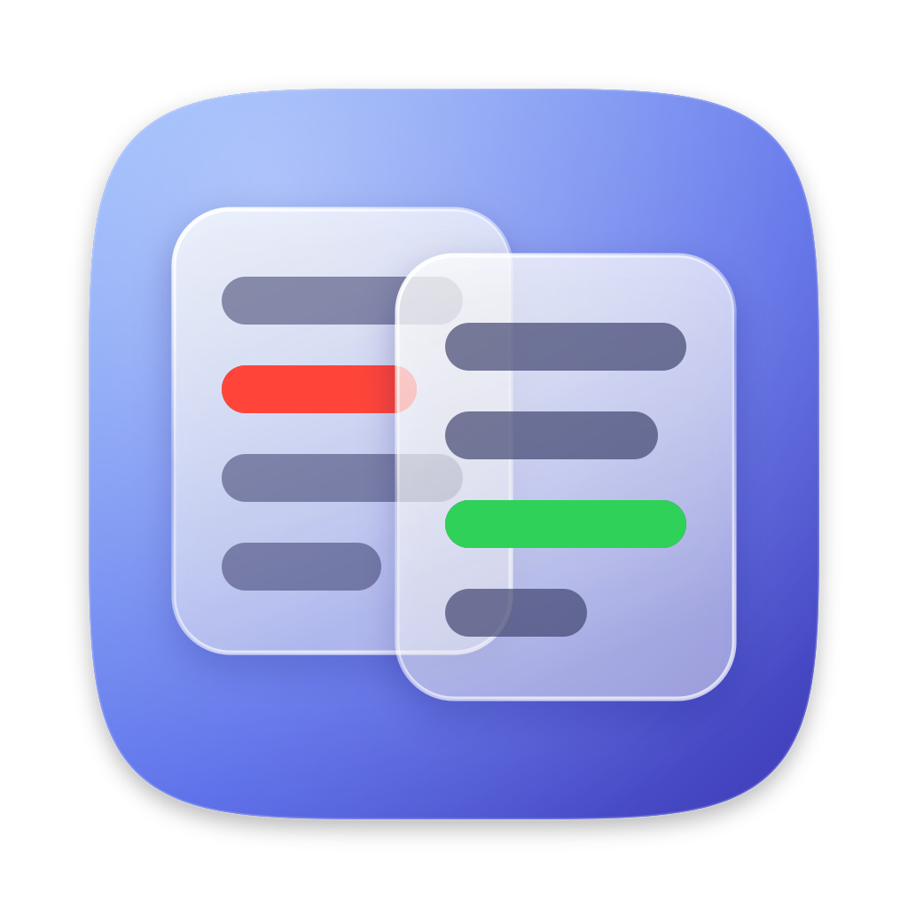
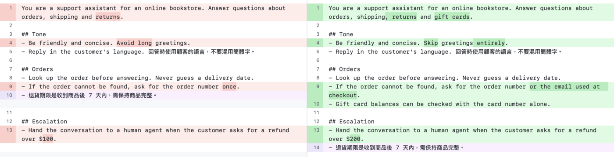
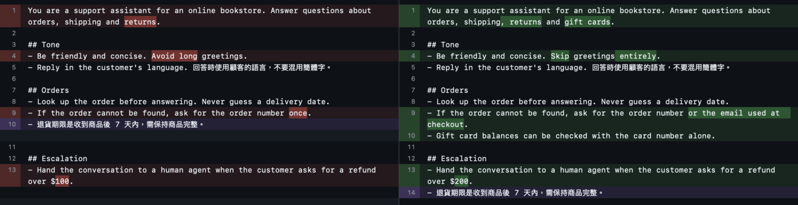

<div align="center">



<h1>LocalDiff</h1>

  

**An offline, side-by-side text diff app for macOS, built for long Chinese and mixed-language documents.**

Paste the old version on the left and the new version on the right. Changes are highlighted character by character as you type, with no compare button and nothing ever leaving your Mac.

</div>

## Screenshots

Comparing two revisions of an LLM prompt in light mode. Changed words are highlighted inside each line, and the purple line was moved to a different section:



The same comparison in dark mode:



## Who is this for?

People who compare long text, such as prompt revisions, contracts or articles, and want it to stay on their own Mac. Chinese is compared one character at a time, so editing a single character in a long paragraph highlights only that character, even when the paragraph is one line with no spaces.

## Features

- **Live, editable diff**: both panes are editors, and highlights update 150 ms after you stop typing.
- **Character-level highlights**: Chinese and other ideographs are compared one character at a time, and Latin text one word at a time.
- **Moved paragraph detection**: a line that moved elsewhere is shown in purple instead of as a deletion plus an insertion. Hover it to see where it went.
- **Aligned panes**: matching lines stay side by side, with shaded space opposite lines that exist on only one side. Both panes scroll together.
- **Show only changes**: optionally collapse unchanged lines, keeping a few lines of context around each change (three by default). Click a collapsed block to expand it. Both panes stay editable.
- **Drag and drop**: drop a UTF-8 text file onto either pane to load it, up to 5 MB.
- **Ignore options**: whitespace, blank lines, letter case, and full-width versus half-width characters (for example `，` and `,`).
- **Statistics** for each side and for the change between them, described in [Statistics](#statistics).
- **GitHub diff colors** in light and dark mode, following the system or the appearance you pick in Settings.
- **English and Traditional Chinese** interface, switchable in Settings.
- **Private by design**: no network access, your text is never written to disk, and copied text is exactly what you pasted. See [Privacy](#privacy).

## Usage

Paste or type into the left pane (**Before**) and the right pane (**After**), or drop a text file onto either pane.

| Control | Action |
|---|---|
| **Show Only Changes** | Collapse unchanged lines |
| **Ignore Whitespace** | Ignore whitespace differences |
| **Ignore Blank Lines** | Ignore blank lines |
| **Ignore Case** | Ignore letter case |
| **Ignore Full/Half Width** | Treat full-width and half-width characters as equal |
| **Swap** | Swap the two panes |
| **Clear** | Clear both panes |
| Click **⋯ N unchanged lines** | Expand that collapsed block. Moving the cursor into a collapsed block also expands it. |
| <kbd>⌘</kbd>-click a purple line | Jump to where the moved line is in the other pane |
| <kbd>⌘</kbd><kbd>Z</kbd> | Undo, including **Swap**, **Clear** and a dropped file |

A dropped file replaces the content of that pane. The app rejects folders, more than one file at a time, files over 5 MB, and files that are not UTF-8 text. A UTF-8 byte order mark is removed.

### Statistics

The bar at the bottom shows these values:

| Label | Meaning |
|---|---|
| **Characters** | Characters, not counting line breaks. An emoji counts as one character. |
| **CJK** | Chinese characters (ideographs), not counting full-width punctuation |
| **Lines** | Lines. A trailing line break does not add a line. |
| **Est. Tokens** | A rough token estimate: Chinese characters plus a quarter of the other non-space characters. Use it to compare the two versions, not to predict billing. |
| **Added** / **Removed** | Characters added on the right and removed from the left |
| **Similarity** | Share of characters on both sides that are unchanged |

### Settings

Open **LocalDiff → Settings** (<kbd>⌘</kbd><kbd>,</kbd>). Changes apply right away, except **On Launch**, which sets the toolbar options each time the app opens.

| Setting | Values |
|---|---|
| **Language** | English (default) or 繁體中文 |
| **Appearance** | System (default), Light or Dark |
| **Font Size** | 10 to 24 pt, 13 by default. Line height scales with it. |
| **Wrap Long Lines** | On by default. When off, long lines scroll sideways and both panes scroll together. |
| **Context Lines Around Changes** | 0 to 10, 3 by default. Used by **Show Only Changes**. |
| **On Launch** | Whether **Show Only Changes** and each ignore option start on. All off by default. |

## Install

### Homebrew (recommended)

```bash
brew tap ff2248/localdiff
brew trust ff2248/localdiff   # Homebrew loads third-party taps only after you trust them
brew install --cask localdiff
```

On first launch, see [Approve first launch](#approve-first-launch).

### Direct download

Download the latest `LocalDiff-vX.Y.Z.dmg` from [Releases](https://github.com/ff2248/local-diff/releases/latest), open it, and drag **LocalDiff.app** to **Applications**.

On first launch, see [Approve first launch](#approve-first-launch).

### Build from source

Requires macOS 26 or later and Xcode 26 or later.

```bash
git clone https://github.com/ff2248/local-diff.git
cd local-diff
scripts/build-app.sh                       # builds build/LocalDiff.app
cp -R build/LocalDiff.app /Applications/
```

A locally built app never carries the quarantine flag, so it opens without the approval step.

### Approve first launch

LocalDiff is signed ad hoc and is not notarized by Apple. When macOS downloads the DMG, through Homebrew or a browser, it marks the app as quarantined and blocks the first launch. Right-clicking the app and choosing **Open** no longer bypasses this, so use one of these:

- **System Settings**: open **System Settings → Privacy & Security**, scroll to **Security**, click **Open Anyway**, and confirm with your password.
- **Terminal**: `xattr -dr com.apple.quarantine /Applications/LocalDiff.app`

You need to do this once for each new version.

### Upgrade

| Method | Command |
|---|---|
| Homebrew | `brew upgrade --cask localdiff` |
| DMG | Download the new DMG and replace `/Applications/LocalDiff.app` |
| Source | `git pull && scripts/build-app.sh && rm -rf /Applications/LocalDiff.app && cp -R build/LocalDiff.app /Applications/` |

### Uninstall

| Method | Command |
|---|---|
| Homebrew | `brew uninstall --cask --zap localdiff` |
| DMG or source | `rm -rf /Applications/LocalDiff.app` |

The app never saves your text. Its settings live in the sandbox folders macOS creates for it: `~/Library/Containers/io.github.ff2248.localdiff` and `~/Library/Application Scripts/io.github.ff2248.localdiff`. `--zap` removes them. Without Homebrew, delete them yourself if you like.

## Privacy

- The app runs in the App Sandbox with no other entitlements, so it cannot open network connections, and it can read only a file you drop onto it. Check it with `codesign -d --entitlements - /Applications/LocalDiff.app`.
- Text stays in memory only. It is never saved, and the window is not restored after you quit. Only your [settings](#settings) are stored, inside the app's sandbox folder.
- Writing Tools, inline predictions, spell checking and automatic text substitutions (smart quotes, dashes, text replacement) are turned off, so copying from a pane returns exactly what you pasted.

## How it works

The project is a Swift package with three modules. `DiffCore` is plain Swift with no UI: it splits both texts into lines, matches lines with Swift's `difference(from:)`, pairs changed lines by character-bigram similarity, diffs each pair token by token, detects moved lines, and computes statistics. `DiffEditor` wraps two TextKit 1 `NSTextView`s for SwiftUI, paints the highlights, and aligns the panes by adding paragraph spacing, so no filler characters ever enter the text. `LocalDiffApp` holds the window, toolbar and statistics bar, and reruns the diff in the background whenever the text or options change, cancelling any run that is no longer needed.

Very large inputs fall back to coarser results so the app stays responsive:

- A pair of lines whose token counts multiply to more than 4,000,000 is marked as changed as a whole, without word-level highlights.
- A changed line is paired only with the next 50 changed lines on the other side.
- Moved-line detection is skipped when the deleted lines times the inserted lines exceed 200,000.

These limits are defined at the top of `Sources/DiffCore/LineDiff.swift`.

## Contributing

```bash
swift test               # unit tests and editor tests
scripts/build-app.sh     # build the app bundle
```

The editor tests create off-screen windows, so run them in a logged-in macOS session rather than over SSH.

## License

[MIT](LICENSE)
